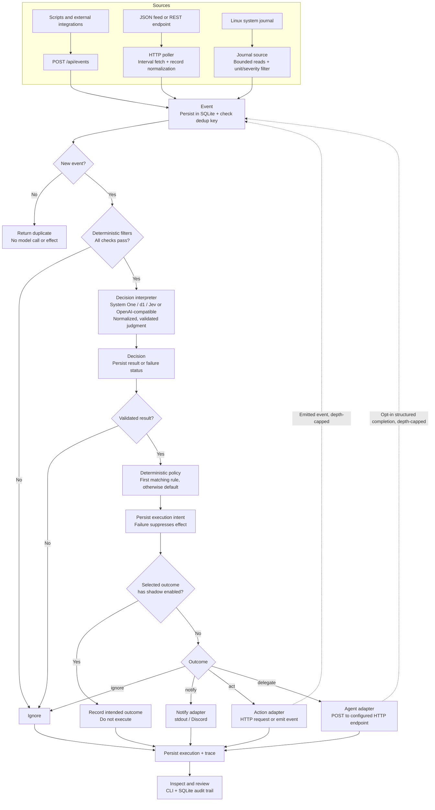

# mrmr

**A local-first, event-driven runtime for ambient AI.** Pronounced “murmur.”

Most AI systems begin with a user prompt. **mrmr begins with an event.** A service fails, a message arrives, or a feed publishes a record. Decision models provide cheap semantic judgment. Generative agents wake only when useful work is warranted. **The runtime, not the model, owns authority.**

**Cheap judgment for everyday events. Capable agents only when they deserve to wake up.**

> **LLM = judgment. Runtime = authority.**
>
> Models interpret events. Configuration and ordinary code determine which effects can run.

Ambient does not mean continuously running a generative LLM:

```text
ordinary software observes → cheap semantic judgment → most events disappear
                                                     → a minority trigger useful work
```

A chatbot or interactive agent starts with a user's task. An unconstrained agent
loop lets a model choose its next task and tools. mrmr does neither: deterministic
policy can delegate bounded work, then observe its externally completed result as
another event. The agent is one possible effect, not the root of the system.

## How it works

The diagram shows the **implemented pipeline**, not the entire roadmap. All ingestion paths use the same runtime; no MCP server, message broker, or agent framework is required.



- **Sources detect, not judge.** The HTTP poller turns each JSON record into an ordinary Event; the journal source emits only selected unit/severity records. External integrations can submit normalized events through the API.
- **Events are stored before interpretation.** Deduplication suppresses repeat deliveries before spending inference. Emitted events also pass a causal-depth guard; depth greater than 10 forces ignore.
- **Filters avoid unnecessary inference.** Missing or incomparable fields fail the check, including `neq` checks.
- **Interpreters have no tools or side effects.** They return a schema-validated Decision. Invalid output or model failure routes to ignore, not policy.
- **Policy selects; adapters execute.** The model does not choose executable commands, endpoint URLs, or new permissions. Shadow is a modifier on a selected outcome, not another adapter.
- **The result is inspectable.** Stored events, decisions, executions, and traces explain the normal processing path. Intent precedes effects; depth and parent/child references survive restart. Duplicate deliveries return a duplicate trace but are not stored as separate events or traces.

Processing is currently **synchronous**: an API request waits for the pipeline, and each poller processes its records serially. SQLite persistence is not yet a recoverable worker queue. See [operational limits](#operational-limits) before relying on unattended actions.

## Current status

mrmr is early-stage software with a working vertical slice, HTTP polling, and a built-in Linux system-journal source.

| Area | Available now |
| --- | --- |
| Ingestion | `POST /api/events`; HTTP JSON polling; selected Linux system-journal events |
| Storage | SQLite events, decisions, executions, traces, source cursors, and human labels |
| Interpretation | Decision providers: Choice, Yes/No, Score via System One (Jev/local d1) or OpenAI-compatible inference; legacy prompt/schema supported |
| Filtering | Scalar `eq` / `neq` checks on event fields |
| Policy | ANDed conditions, first-match rules, explicit default |
| Outcomes | Ignore, stdout/Discord notify, HTTP action, emit-event, HTTP delegation with opt-in structured completion events, shadow |
| Review | Parent/child inspection, labels/export, decision vs structured-output evaluation, confusion, precision/recall, probability buckets, false-ignore rate |
| Dashboard | Private read-only activity, source-poll health, policy boundaries, event traces, and model request latency |
| Connections | Standalone Superhuman OAuth login and read-only connection check; email polling is not implemented yet |

**Not implemented:** MCP polling or tool calls, native SaaS integrations, built-in cron, XML RSS parsing, Telegram and other notification adapters beyond stdout/Discord, exec actions, permission/approval queues, a flow/configuration editor, multiple independently routed flows, or hot reload.

The included 50-event evaluation set is generated. The required quality gate—at least 50 labeled **real** events, with measured accuracy and false-ignore rate—has not yet been completed. A passing test suite is not evidence that a model is ready to make judgments on your events.

[IMPLEMENTATION.md](IMPLEMENTATION.md) describes the broader design and milestone behavior. Its future examples are not all valid configuration for today's binary.

## Let your agent set it up

Give your agent this repository and ask:

> Follow [SETUP.md](SETUP.md) to configure and verify mrmr for me. Keep effects disabled and ask before enabling network access or a background service.

The runbook covers environment checks, safe configuration, a real-model smoke test, persisted traces, duplicate suppression, and handoff. It does not require an agent-specific plugin or skill.

## Quick start

You need:

- **Go 1.27**, as declared in [go.mod](go.mod).
- A decision endpoint: **OpenAI-compatible** `/chat/completions`, **native System One** (such as local d1), or a TypeSafe account for Jev. The shipped quick-start config uses OpenAI-compatible inference. For local d1 on CPU or CUDA BF16, start with the [local d1 recipe](recipes/local-d1/README.md). Any hosted endpoint receives the event content sent for interpretation.

Build and configure:

```bash
go build -o mrmr ./cmd/mrmr
cp mrmr.example.yaml mrmr.yaml
```

Edit `mrmr.yaml`:

- Set `server.addr` to `127.0.0.1:4242` for local-only access. The example's `:4242` listens on all interfaces.
- Set `models.fast-local.base_url` and `model` for your endpoint. Include `/v1` if your server requires it.
- If authentication is required, set the environment variable named by `api_key_env`. Do not put its value in YAML. Omit `api_key_env` for an unauthenticated endpoint.

Then start the runtime:

```bash
./mrmr run -config mrmr.yaml
```

Open **http://localhost:4242/dashboard/** to view source health, stored events,
shadow outcomes, and model request latency. For a remote runtime, use
[private HTTPS through Tailscale Serve](#private-https-with-tailscale-serve).

In another terminal, send an event:

```bash
curl --fail-with-body http://127.0.0.1:4242/api/events \
  -H 'Content-Type: application/json' \
  -d '{
    "type": "test.message",
    "source": "curl",
    "subject": "production-api",
    "data": {
      "message": "The production API has returned 500 errors for five minutes."
    },
    "metadata": {
      "source_event_id": "quickstart-001"
    }
  }'
```

The example policy notifies stdout when the model classifies an incident with confidence above `0.85`; otherwise it ignores. The actual outcome depends on your model's judgment.

The JSON response includes `event_id` and `trace`, plus `decision`, `outcome`, or `duplicate` when applicable. Inspect a newly stored event using its returned ID:

```bash
./mrmr inspect evt_01... -config mrmr.yaml
```

Repeating the request with the same source and `source_event_id` returns a duplicate without invoking the model. Change the ID to submit a distinct event. A duplicate response's newly generated ID is not a stored event ID; use the original delivery's ID for inspection.

## Configuration

[mrmr.example.yaml](mrmr.example.yaml) is the complete starting point. One YAML file configures one shared filter/policy pipeline, model endpoints, HTTP agent targets, and polling sources. `interpret_by_type` can replace the interpreter contract for an exact event type. All events still use the same ingestion path; there is no `on:`-based flow routing.

Configuration is validated at startup; unknown YAML keys and unsupported adapter types are errors. Restart to apply changes.

### Filter first, interpret second

Filters check event fields before calling the model:

```yaml
filter:
  - field: source
    op: neq
    value: noise-bot
```

All checks must pass. `eq` is the default operator. Fields can address `type`, `source`, `subject`, or nested scalar values such as `data.author` and `metadata.origin`; an optional `event.` prefix is accepted.

For an `openai-compatible` model, `interpret` selects a prompt and flat result schema. Supported field types are `string`, `number`, and `boolean`, with optional enums and numeric bounds. Every declared field is required, and extra result fields are rejected.

The OpenAI-compatible client requests schema-constrained decoding. If the endpoint rejects that request with HTTP 400, it retries without the response format; runtime validation still applies. Invalid output gets at most one self-correction retry. Format fallback, self-correction, and endpoint retries share a maximum of three completion attempts. Endpoint HTTP errors retain the status code, not the response body, so reflected credentials or private prompts cannot enter traces through error pages.

### Decision models and worker models

`models.<name>.role` separates `decision` from `agent`. An omitted role preserves
legacy interpretation. An agent-role model cannot be used by an interpreter.
Agents can reference only explicit agent-role models:

```yaml
models:
  judge:
    role: decision
    provider: liquid-d1
    base_url: http://127.0.0.1:8091/v1
    api_key_env: MRMR_D1_API_KEY
    model: YOUR_PINNED_D1_MODEL_ID
  worker:
    role: agent
    provider: openai-compatible
    base_url: http://127.0.0.1:8081/v1
    model: LFM2.5-2.6B
agents:
  homelab:
    endpoint: http://127.0.0.1:9000/tasks
    model: worker
    read_only: true
    capabilities: [journal.read, service.status]
```

The worker is a configured model hint sent to the external agent endpoint, **not**
an embedded agent loop or a direct chat-completions task API. The external harness
owns model authentication and enforces tool limits. mrmr never sends model API
keys to it. Capability hints do not grant permissions or create a sandbox.

Decision providers implement a bounded `Decide(questions, event)` contract:

| Question | Normalized answer fields |
| --- | --- |
| `choice` | `type`, `choice`; optional `probabilities`, `confidence` |
| `yes_no` (legacy alias `noul`) | `type: yes_no`, boolean `value`; optional `probability` of yes |
| `score` | `type`, `score` on zero-based configured levels; optional `probabilities`, `confidence`, `legend` |

Confidence and probability are not interchangeable. Available native values are
preserved; System One's `noul` remains an additive compatibility field. The Yes/No
boolean uses a 0.5 boundary, while policy can impose a stricter probability gate.
Absent confidence/probabilities stay absent and cannot satisfy a threshold.

- `typesafe` uses Jev's System One transport.
- `system-one` is the provider-neutral selector for that contract.
- `liquid-d1` uses System One: `POST /systemone` below `base_url`. It supports
  the [verified local recipe](recipes/local-d1/README.md). Liquid's documented
  [hosted API](https://docs.liquid.ai/lfm/models/decision-models) uses
  `base_url: https://api.liquid.ai/decisions/v1`, `model: d1:free`, and
  `api_key_env: LIQUID_API_KEY`. No hostname-specific routing is needed. The
  hosted transport has offline contract tests, not a live credentialed test.
- `openai-compatible` accepts the same `interpret.questions` and uses constrained
  generation plus validation. It returns typed choices/booleans/scores, without
  fabricated probabilities or confidence. Existing `prompt`/`schema` configs keep
  their flat results and retry behavior. Do not mix questions with prompt/schema.

Policy sees normalized answers, never transport-specific response envelopes.
The [homelab ambient recipe](recipes/homelab-ambient/README.md) shows the complete
judge → investigate → completion → follow-up judgment loop, shadowed by default.

### TypeSafe Jev

Jev is an optional hosted interpreter. Configure typed questions instead of a generative prompt/schema:

```yaml
models:
  jev:
    provider: typesafe
    base_url: https://api.typesafe.ai/v1
    api_key_env: TYPESAFE_API_KEY
    model: jev-1.13.0

interpret:
  model: jev
  questions:
    category:
      type: choice
      instructions: Which category best describes this event?
      criteria:
        incident: Something is broken now.
        noise: Routine activity needing no attention.
        FYI: Useful information requiring no action.
    requires_action:
      type: noul
      instructions: Does this event genuinely require operator action?
      criteria:
        true: Intervention or investigation is warranted.
        false: No operator action is warranted.
```

Choice, Yes/No (Noul), and Score questions are sent together in one `POST /systemone` request. Their validated answers are normalized before persistence and policy. Policy addresses `result.category.choice`, `result.category.confidence`, `result.requires_action.value`, and `result.requires_action.probability`. Existing `.noul` paths still work. Noul has no separate confidence value.

TypeSafe responses are validated against the configured questions before policy can see them. Network failures, `429`, and `5xx` responses retry within three attempts; other client errors fail immediately toward ignore. Pin a Jev version when tuning thresholds: aliases can move. The complete [Jev journal recipe](recipes/homelab-journal/mrmr.typesafe.example.yaml) is shadowed by default.

TypeSafe is an external service. Filters still run first, but every event reaching interpretation is sent to the configured endpoint. Review data sensitivity and retention requirements before using hosted interpretation, especially for email or journal events.

### Policy and outcomes

Rules evaluate from top to bottom. Conditions within a rule are ANDed; the first match wins. No match selects `default`.

```yaml
policy:
  - if:
      result.category: incident
      result.confidence: "> 0.85"
    then:
      notify:
        via: stdout
        message: "{{ .result.summary }}"

default:
  ignore: true
```

Conditions support literal equality and operator strings: `>`, `>=`, `<`, `<=`, and `!=`. Dot-separated paths can traverse nested result objects. `event.type`, `event.source`, `event.subject`, `event.depth`, and `event.data.*` can constrain effects without model judgment. There is no OR or nested boolean expression language; use separate rules for alternatives.

| Outcome | Configuration under `then` | Behavior |
| --- | --- | --- |
| Ignore | `ignore: true` | Record the outcome; no external effect |
| Notify | `notify: {via: stdout}` | Print a message; optional Go `message` template |
| Discord notify | `notify: {via: discord, webhook_env: MRMR_DISCORD_WEBHOOK_URL}` | Send to a fixed webhook from the environment; same message template |
| Act via HTTP | `action: {type: http, url: "http://127.0.0.1:9000/hook"}` | Send to a configured URL; default method is POST; optional `method` and `body` |
| Emit event | `action: {type: emit, event_type: incident.escalated}` | Re-enter the same pipeline with the decision result as event data |
| Delegate | `delegate: {agent: triage, prompt: "Investigate this event."}` | POST to `agents.triage.endpoint`; HTTP 2xx means accepted |

Notify messages and HTTP action bodies use Go templates. They can read nested decisions such as `{{ .result.category.choice }}` and the normalized event through `{{ .event.id }}`, `.type`, `.source`, `.subject`, `.timestamp`, `.data`, `.metadata`, and `.depth`. An omitted HTTP action body sends the decision result as a JSON object, without the event-ID prefix used by stdout notifications. Delegation retains `{event_id, decision, prompt}` and adds the event, runtime lineage, and configured worker/capability hints. The prompt is configured text, not a rendered template. Completion re-entry is **off by default**; enable it explicitly as described below.

**Start with shadow when testing effects.** Add `shadow: true` beside the outcome in each rule you want suppressed:

```yaml
then:
  notify:
    via: stdout
    message: "{{ .result.summary }}"
  shadow: true
```

This records the selected notification without printing it. Shadow does not skip interpretation or storage. Setting shadow only in `default` does **not** suppress effects from matching policy rules.

### Discord notifications

Keep the webhook URL in an environment variable or a private service environment file, never in YAML or Git:

```yaml
then:
  notify:
    via: discord
    webhook_env: MRMR_DISCORD_WEBHOOK_URL
    message: "Review {{ .event.subject }} — event {{ .event.id }}"
  shadow: true
```

Only HTTPS webhooks on `discord.com` are accepted. Each send has a 10-second limit, no redirects or application retries, disabled mentions and link previews, and a 2,000-character bound (counted conservatively as UTF-16 units). Discord must confirm message creation (`wait=true`). Errors and traces omit the credential-bearing URL and response body. Missing or invalid secrets produce an execution error; they do not change the destination. Shadow rules do not resolve the secret or send a request.

Discord is an external service. Use a short unit/event reference instead of raw journal text unless you explicitly want to share that text. A timeout can leave delivery uncertain; mrmr does not retry or replay the effect.

### Delegation completion re-entry

```yaml
then:
  delegate:
    agent: homelab
    prompt: Investigate this event using read-only checks.
    emit_completion: true
    completion_event_type: agent.investigation.completed
  shadow: true
```

Without `emit_completion`, any 2xx response still means accepted and its body is
ignored. With it, the endpoint must return a terminal JSON object synchronously:

```json
{"status":"completed","summary":"Service recovered","findings":[],"evidence":[],"recommended_action":"no_action","metadata":{}}
```

Only `status` is required (`completed`, `failed`, or `cancelled`). Optional
`started_at`/`completed_at` timestamps use RFC3339. Unknown envelope fields,
malformed JSON, HTTP 202, and responses over 1 MiB fail without creating a child.
Calls have a 10-second default deadline (`agents.<name>.timeout` can set 1s–5m),
no redirects, and no effect retries. There is no
asynchronous callback protocol. See the [full contract](recipes/homelab-ambient/README.md#external-agent-contract).

The runtime emits the configured type (default `agent.completed`), source
`mrmr.agent`, parent subject, `data.agent`, and `data.result`. Runtime-owned
`provenance` references the origin/parent event, decision, execution, policy
rule/hash, and agent. The result cannot set these fields or reset depth.
The new event passes normal persistence, dedup, filters, interpretation, and
policy. Depth greater than 10 is stored and forced to ignore without inference.

Use an exact `interpret_by_type` override for follow-up questions, and use
`event.type`/`event.depth` policy checks to avoid redelegation. All shared filters
still apply, so journal-only field requirements can exclude completion events.
A shadow delegation creates no agent call or completion event. Failed work is
an observation, not permission to act. Recommendations and evidence URLs remain
data; only static configuration can select executable destinations.

### Compatibility and migration

Existing role-less models, OpenAI prompt/schema interpretation, TypeSafe questions,
and simple 2xx agent endpoints remain supported. No completion re-entry is enabled
by an upgrade. System One Yes/No answers now have `type: yes_no`, `value`, and
`probability`; the original numeric `noul` field remains. Choice/Score native values
are preserved. Clients matching the old literal `type: noul` must update.
`event.*` policy paths now address event facts; use `result.event.*` if an existing
question is named `event`. Delegation requests contain additive fields; endpoints
that reject unknown request keys must accept the expanded contract.

SQLite receives one additive, transactional migration for stored depth, provenance,
and execution policy references. Old rows are retained with depth 0 and no lineage;
historical depth was not stored and cannot be reconstructed. Back up the database
before upgrading. Intent is now persisted before effects; a pending row after a
crash is not automatically retried. Action/agent redirects and templated or
credential-bearing action/agent URLs are now rejected; configure the final static
HTTP(S) destination instead.

## Ingesting events

### HTTP API

`POST /api/events` accepts:

| Field | Meaning |
| --- | --- |
| `type` | Required event type, for example `service.unhealthy` |
| `source` | Required producer identity; also scopes deduplication |
| `subject` | Optional entity the event concerns |
| `data` | Optional JSON object containing the event payload |
| `metadata` | Optional JSON object; use `source_event_id` for a stable delivery identity |

The API assigns event IDs and timestamps. Request bodies are limited to 1 MiB. Model or adapter failures are reported through the decision/trace, not necessarily a failing HTTP status; inspect the response rather than treating HTTP 200 as proof an effect succeeded.

Deduplication uses `(source, metadata.source_event_id)`. IDs must be non-empty strings or JSON numbers; missing, null, empty, boolean, or compound IDs fall back to hashing the event type, subject, and data. Numeric payloads and IDs retain their JSON spelling without float64 rounding, including during inspection and dataset export. Prefer stable string IDs; when using numbers, keep their spelling consistent between deliveries. Give genuinely separate occurrences distinct IDs, even if their payloads are identical.

**Upgrade note:** earlier versions rounded JSON numbers and formatted numeric dedup keys through float64. Exact-number ingestion can therefore assign a different key to a replayed numeric-ID or payload-hashed event. Existing rows/cursors are not rewritten, and previously rounded or dropped data cannot be reconstructed automatically. Use shadow outcomes when checking overlapping feeds after an upgrade; do not assume old numeric dedup keys prevent repeated effects.

This endpoint accepts **normalized events**, not arbitrary provider webhook formats. A script or integration must translate provider payloads and handle any required webhook authentication before submitting them.

### HTTP polling

Add a source to the same config:

```yaml
sources:
  - name: blog-feed
    type: http-poller
    url: "https://example.com/feed.json"
    every: 2m
    item_path: items
    cursor_field: id
    subject_field: title
    timestamp_field: published
    event_type: feed.item.published
    # bearer_token_env: FEED_TOKEN
```

- Polls immediately, then on the configured interval (minimum `1s`), with one serial loop per source.
- Performs an HTTP GET with a 15-second timeout and a 4 MiB response read limit. A failed fetch leaves the cursor unchanged; the next tick retries.
- Reads a JSON array at `item_path` (a dot-path); omit it for a top-level array. This is not an XML RSS/Atom parser.
- Preserves each record as `event.data`; the source name becomes `event.source`. Subject and timestamp fields refer to top-level record fields. Timestamps use RFC3339; missing or invalid timestamps fall back to now.
- Uses `cursor_field` as the dedup ID and stores a watermark in SQLite. Without it, payload-hash deduplication applies. Missing, empty, null, boolean, or compound configured IDs are skipped and hold the watermark; changes to a record with the same ID do not create a new event.
- Resolves an optional bearer token from the named environment variable at startup.

For compatible APIs, the URL may use `?after={{ .cursor }}`. **This is a basic watermark, not general pagination:** it is the string maximum of the fetched record IDs, not an opaque server continuation token. Substitution is literal, without URL escaping. The watermark changes only after every record is normalized and accepted by ingestion without cancellation; failed or malformed records hold the old cursor for the next poll, while successful records deduplicate on replay. A permanently malformed record holds the cursor until the source is corrected. This does not recover already-persisted, half-processed events after a crash or downstream persistence failure. Prefer overlapping recent-record feeds for initial dogfooding; do not rely on this for lossless incremental synchronization.

**MCP polling is planned, not available.** Setting `type: mcp-poller` fails validation. For now, an external MCP client can normalize records and submit them through `POST /api/events`.

### Linux system journal

One source in your mrmr configuration is enough—no forwarding script, timer, or second service:

```yaml
sources:
  - name: system-services
    type: systemd-journal
    units: [plexmediaserver.service, lfm25.service]
    priority: warning
    every: 30s
    event_type: system.service.warning
```

The [complete shadow-mode example](recipes/homelab-journal/mrmr.example.yaml) includes a model schema and policy. Edit its endpoint and unit names for your host; copying a source into another config does **not** automatically shadow that config's outcomes.

- Requires Linux, `journalctl` with `--lines=+N` support, and system-journal read permission. Startup checks these prerequisites before starting any sources. HTTP-only configurations remain portable.
- Selects exact **system** units and priorities at or above the chosen severity: `emerg`, `alert`, `crit`, `err`, `warning`, `notice`, `info`, or `debug`. No unit globs, user-unit support, remote journals, or automatic historical backfill. Hermes running as a user service is outside this initial slice. System services that run as a regular UID are supported: their records can reside in per-user journal files. Trusted unit fields, not file ownership, enforce selection.
- First activation checkpoints the current accessible journal tail without interpreting history. Later starts resume the SQLite cursor. Changing the unit selection does not replay old records.
- Scans at most **100 accessible journal records per tick**, oldest first, applying unit/severity checks before ingestion. Unselected records advance the checkpoint without becoming Events. Busy journals can lag; shorten `every` (minimum `1s`) if needed. Each journalctl process is bounded to 15 seconds and 4 MiB stdout, and is reaped before model calls.
- Persists selected Events with the unit as `subject`, the original journal timestamp, and `data.unit`, numeric `data.priority`, and `data.message`. Manager-emitted service transitions are recognized through PID 1's `UNIT` field. Binary/oversized journal fields are marked `message_omitted`; text is capped at 4096 bytes with `message_truncated` when necessary. Other journal fields are not copied into event data.
- Uses the journal's opaque cursor as `metadata.source_event_id`. Failed batches retain the checkpoint; already stored records deduplicate. This does not repair the runtime's partial-processing/crash-recovery limitations.
- An inaccessible or vacuumed checkpoint causes a clear error, **not** a silent jump to the tail. Restore access/retained journals, or explicitly choose a new source name if abandoning the old position is acceptable. Old data is not deleted automatically.

**Permissions:** run `journalctl --system --no-pager -n 1 -o json --output-fields=__CURSOR` as the same account that runs mrmr. If access is denied or journalctl warns, have an administrator grant appropriate read access (often membership in `systemd-journal` or `adm`), then restart the login/service session. Group membership grants broad journal visibility: ask before changing it. Do not run mrmr as root to bypass this check. A host with no readable journal entries also fails startup rather than pretending the source works.

Journal content may contain credentials or private application data. Unit filtering is not secret redaction. Start with shadow, use an approved model endpoint, and review selected records before trusting this source. Avoid selecting mrmr's own unit; the adapter excludes its current process's journal messages to prevent immediate feedback.

## Read-only dashboard

With `mrmr run` active, open **http://localhost:4242/dashboard/** (use your configured port).
The HTML, CSS, and JavaScript are embedded in the Go binary. Local access needs
no frontend service, build tool, external asset, or extra configuration.
The page names the runtime host and works on desktop and phone screens.
It cannot change labels, configuration, policy, or services.

The dashboard requires a loopback peer and a local Host header by default,
even when the ingestion listener binds more broadly. Proxy headers do not
bypass this check. Do not expose or proxy the unauthenticated ingestion API.

### Private HTTPS with Tailscale Serve

For everyday remote access without an SSH tunnel, use **Tailscale Serve**.
Configure a separate read-only listener in the same process. Replace the hostname with your node's exact
Tailscale DNS name; both settings are required:

```yaml
server:
  addr: 127.0.0.1:4242
  dashboard_addr: 127.0.0.1:4244
  dashboard_host: your-host.your-tailnet.ts.net
```

`dashboard_addr` must use a literal loopback IP and a nonzero port.
`dashboard_host` adds one exact hostname to the Host allowlist; it does not
permit remote socket peers, arbitrary proxy headers, or cross-origin reads.
Restart mrmr after changing configuration. On that same host, inspect existing
Serve routes, then add only the dashboard route:

```sh
tailscale serve status
tailscale serve --bg --set-path=/dashboard/ http://127.0.0.1:4244/dashboard/
# Open https://your-host.your-tailnet.ts.net/dashboard/
```

Keep existing routes intact. Never enable Funnel. The second listener has no
event-ingestion routes, even if a proxy rewrites paths. Access follows existing
tailnet permissions for the node's HTTPS port; the dashboard adds no separate
sign-in. Restrict those permissions if other tailnet users must not read events.

Once configured, open the HTTPS URL from a device connected to your tailnet.
mrmr and SQLite stay on the server; the browser is only a read-only view.

### SSH tunnel alternative

For temporary remote access without Serve, keep the ingestion listener on
loopback and forward it through SSH:

```sh
ssh -N -L 127.0.0.1:14242:127.0.0.1:4242 YOUR_HOST
# Open http://127.0.0.1:14242/dashboard/
```

Keep the SSH session running while you use the page. If you configured the
separate read-only listener above, forward port `4244` instead of `4242`.

### What the dashboard shows

The page refreshes every 10 seconds while visible and shows:
- Runtime response timestamp and process start time, with a stale-data warning on failure.
- Source scope and the current process's last started, finished, and successful poll.
  Empty successful polls count. Cursor age alone is not a health signal. Polls
  that exceed three intervals (at least 30 seconds) are marked overdue, not dead.
  A source can complete a batch while individual model calls fail.
- Searchable events in 50-row pages, with separate decision and execution states,
  unlabeled/error/shadow filters, and full event inspection.
- Exact repeated messages in the latest 1,000 events, without classifying them
  as harmless. Summary messages are shortened after redaction.
- Configured policy conditions and shadow boundaries, without effect arguments.

**Latency:** every Decision already stores `latency_ms` in SQLite, including
failures. A payload-free service log now records that timing for API and source
events alike. It sums client-side model requests across attempts, including
network/server time but excluding retry waits and the rest of the pipeline.
It is **not GPU-only inference time**. The dashboard groups the latest 1,000
Decisions across all models by interpreter and exact model identity. Median and
p95 use successful Decisions only, with nearest-rank percentiles. Failures remain
visible separately; timeout counts use recorded timeout/deadline error text and
count Decisions, not attempts. Historical records work without replay or new
model calls. No samples means unknown, not zero.

The latest recorded success does not prove that a model is reachable now.
Poll health resets on process restart; historical poll failures are not stored
by this view. A dashboard served by mrmr cannot independently alert when mrmr
is down.

Read endpoints: `GET /dashboard/api/overview`,
`GET /dashboard/api/events?q=TEXT&view=all&offset=0`, and
`GET /dashboard/api/event?id=EVENT_ID`. Views are `all`, `unlabeled`,
`shadow`, `ignore`, and `errors`. Queries have a five-second context deadline;
responses are capped at 4 MiB. Event detail includes `event_json`, a redacted
display string that preserves large JSON numbers without browser rounding.
These routes never ingest events, call models, write labels, or execute effects.

All responses disable caching. URLs, common credential fields, and configured
secret values are redacted. Arbitrary event text can still contain private
information: this is not a public-safe export. Keep host, tailnet, and tunnel access private.
The upgrade adds two transactional indexes for recent-event and decision queries;
it does not rewrite events or change policy. Back up SQLite before upgrading.

## Inspect, label, and evaluate

Review stored events and their traces:

```bash
./mrmr events -config mrmr.yaml -limit 20
./mrmr events -config mrmr.yaml -unlabeled
./mrmr inspect evt_01... -config mrmr.yaml
```

`events` emits one JSON object per row. `inspect` returns the stored event, decisions, executions, ordered trace, and human label if present. Parent inspections include `child_event_ids`; child events include `provenance` and persisted `depth`. Execution rows identify the selected policy rule and policy content hash without copying ancestor payloads.

Capture real events, label the expected judgment, then export a dataset:

```bash
./mrmr label evt_01... -config mrmr.yaml \
  -category incident -requires-action=true -outcome notify
./mrmr dataset export -config mrmr.yaml \
  -output testdata/real-eval.jsonl
./mrmr eval -config mrmr.yaml -dataset testdata/real-eval.jsonl
```

Relabeling replaces the previous label. Labels support `ignore`, `notify`, `act`, and `delegate`. Decision-model labeling validates the configured `category` Choice, including the exact event-type override for completion events. Evaluation grades intended outcomes; it does not benchmark worker execution.

For prompt development before real data is available:

```bash
./mrmr eval -config mrmr.yaml -dataset testdata/generated-eval.jsonl
```

Evaluation calls the interpreter and evaluates policy without executing effects or writing runtime events. Recorded event IDs, timestamps, and numeric payloads are preserved; deterministic defaults fill only missing IDs/timestamps in generated fixtures. It does not run ingestion gates (deduplication, pre-model filters, or the depth guard). It reports decision vs structured-output call counts, category and outcome accuracy, per-class precision/recall, a confusion matrix, and false-ignore rate. Invalid decisions remain in the denominator and appear as `<invalid>` predictions. Probability buckets compare the selected choice's probability with observed accuracy; they never substitute confidence. Decision evaluation expects a `category` Choice; `requires_action` Yes/No labels are optional in JSONL and use their own labeled denominator. Missing answers are not graded as correct negatives. Use `-mode decision` or `-mode structured-output` to select a contract before inference (default: `all`). Use separate datasets to evaluate initial and completion judgments. Event-type overrides and event-aware policy are applied, but no worker/effect is called. Use the generated set as a baseline, then grade at least 50 representative real events against your own acceptance thresholds before trusting a flow.

Exports contain complete event payloads. Real evaluation datasets are ignored by Git by default, but inspect and anonymize them before sharing.

## Superhuman connection setup

This establishes an **mrmr-owned** OAuth connection, independent of Pi or any
other agent. It does **not** implement email polling or activate a flow.
Superhuman Mail requires Business or higher. Link additional accounts separately
in Superhuman's MCP session; signing in does not automatically expose every
account visible in the Mail app.

```bash
go build -o mrmr ./cmd/mrmr
./mrmr auth login superhuman
# Open the private sign-in URL printed in your terminal.
./mrmr auth check superhuman
```

Login expires after five minutes and listens only on `127.0.0.1:18742`. Check
is non-interactive, refreshes expired access tokens, verifies required read tools,
and reports the linked-account count without fetching email bodies. No model is
called. The browser callback only confirms receipt; the terminal reports whether
login actually succeeded.

Credentials are stored in `os.UserConfigDir()/mrmr/superhuman/credentials.json`
(`~/.config/mrmr/superhuman` on typical Linux installations, or
`~/Library/Application Support/mrmr/superhuman` on macOS). This is a **plaintext,
mode-0600 secret file in a mode-0700 directory**, not an encrypted keychain. Keep
it out of Git, flow YAML, logs, and unencrypted/shared backups. Both commands
accept `-state-dir /absolute/private/path` to use a dedicated directory.

For a headless server, sign in as its intended service user through a loopback
SSH tunnel rather than copying an agent's tokens:

```bash
ssh -L 18742:127.0.0.1:18742 marvin
# In that SSH session, with the installed binary:
~/mrmr/mrmr auth login superhuman
```

Open the printed URL in your local browser with the tunnel still running. If the
port is occupied, choose another with `-callback-port` and forward that same port.
No firewall changes or public callback listener are needed.

The connection pins Superhuman's HTTPS origins and rejects redirects. OAuth
consent may grant broader access than read-only mail: the application enforces
its own fixed tool calls; tool annotations do not confer permission. This slice
only invokes `list_accounts`. It does not send, archive, mark read, or fetch mail.

One process owns a credential directory at a time to protect rotating refresh
tokens. Stop that connection before login/check from another process. A denied
login leaves the previous grant intact. Refresh failures fail closed and require
repair or a new login; they never launch an unattended browser or expand scopes.
A crash between server-side token rotation and local persistence can still
require signing in again. Real-provider unattended behavior remains to be
verified; offline tests do not establish it.

## Operational limits

**Use on a trusted local network, initially with ignore, stdout, or shadow outcomes.**

- **No API authentication.** Prefer a loopback bind. For remote access, use a trusted private network and appropriate access controls; do not expose port 4242 directly to the internet. Ingestion can trigger configured actions.
- **No permission or approval layer yet.** Configured policy is the current authority boundary. There is no approval queue, automatic stale-event action downgrade, or action sandbox.
- **Persistence is not crash recovery.** There is no queue replay for half-processed events. Execution intent is stored before effects; failures to store intent suppress the effect. A crash can leave a pending execution, lose a completion before it is stored, or leave a partial trace. Pending work is not automatically retried. Deduplication is not an exactly-once execution guarantee.
- **Polling is deliberately basic.** No general pagination, arbitrary cursor ordering, or durable ingestion retry queue. Slow interpretation delays the next record in that source.
- **Stored data can be sensitive.** Events, structured decisions, and traces persist in SQLite; API processing also prints response traces. Full prompts and successful raw model responses are not stored as separate artifacts. Endpoint HTTP error bodies are discarded; HTTP error traces contain status codes only. This does not remove sensitive material already stored or logged by older versions. Protect the database, logs, and exports.
- **Secrets belong outside config.** Use `api_key_env` for model authentication, `bearer_token_env` for pollers, and `webhook_env` for Discord notifications. Do not put credentials in URLs, event payloads, or prompts.

## Deployment

The runtime is one Go binary plus a YAML file and SQLite database. No Redis, Postgres, or cloud account is required.

Model serving is separate from mrmr. The [local d1 recipe](recipes/local-d1/README.md) covers native CPU and CUDA-BF16 decisions; the [homelab ambient recipe](recipes/homelab-ambient/README.md) shows separate decision/worker roles and shadowed policy. A generative model endpoint alone is not an investigator task endpoint: an external harness must implement the agent contract and enforce tool limits. Keep notification and delegation rules shadowed until real-event evaluation supports promotion.

For a Linux x86-64 host:

```bash
GOOS=linux GOARCH=amd64 go build -o mrmr ./cmd/mrmr
scp mrmr mrmr.yaml home-server:~/mrmr/
```

Create the destination directory first; use `GOARCH=arm64` for an ARM64 host. On the host, set an appropriate bind address and an absolute `db.path` in the config, then supply any referenced credentials through the service environment.

Example systemd user unit at `~/.config/systemd/user/mrmr.service`:

```ini
[Unit]
Description=mrmr ambient event runtime
After=network-online.target

[Service]
WorkingDirectory=%h/mrmr
ExecStart=%h/mrmr/mrmr run -config %h/mrmr/mrmr.yaml
Restart=on-failure

[Install]
WantedBy=default.target
```

```bash
systemctl --user daemon-reload
systemctl --user enable --now mrmr
journalctl --user -u mrmr -f
```

A user service needs lingering enabled if it should remain running after logout. The unit above does not provision secrets; arrange their environment separately before starting an authenticated setup.

## Roadmap

The [development phases](IMPLEMENTATION.md#development-phases) are the source of truth; this is direction, not a list of shipped capabilities:

1. **Prove the loop:** complete real-event evaluation of the core pipeline.
2. **Useful daemon:** expand sources, notifications, actions, retries, and permissions. HTTP polling is already implemented.
3. **Local UI:** event timeline, trace inspection, configuration, approvals, and health.
4. **Real integrations:** build adapters from actual dogfooding needs, including an MCP poller.
5. **Delegation and ecosystem:** native agent integrations and asynchronous completion delivery; synchronous HTTP completion events are available now. SDKs only when real implementations justify them.

mrmr is not a general-purpose workflow engine, an agent framework, or an MCP platform. The core stays small: **Source → Event → Interpreter → Decision → Policy → Outcome → Adapter.**

## Development

```bash
go test ./...
go build ./...
```

Code lives under `cmd/mrmr` (CLI and HTTP server) and `internal` (configuration, source, event, filter, model, policy, runtime, and storage). Tests use local fixtures and mock HTTP servers; no real model endpoint or credentials are required.

See [AGENTS.md](AGENTS.md) for contribution constraints and [IMPLEMENTATION.md](IMPLEMENTATION.md) for the design.

## License

[MIT](LICENSE)
